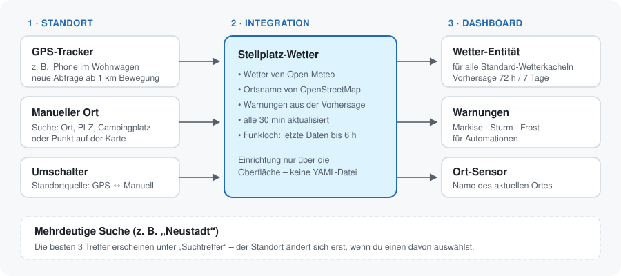

<p align="center"></p>

# Stellplatz-Wetter (Pitch Weather)

Weather **with forecast** for wherever your caravan or motorhome is parked right now – exposed as a regular
Home Assistant weather entity, so every standard weather card works. Set up entirely through the UI.

[Deutsche Version](README.md) · [Changelog (German)](CHANGELOG.md)

## Features

- **Location from a GPS tracker** (`device_tracker` or `person`, e.g. an old phone running the Companion App) – refreshes after moving more than 1 km
- **Manual location**: search by place name, postal code (`84130`, `6020, AT`) or campsite, or pick a point on the map
- Ambiguous searches show the **top 3 results** to choose from – the location only changes after you pick one
- **Forecast**: hourly (72 h) and daily (7 days) via [Open-Meteo](https://open-meteo.com), no API key
- **Warnings** (binary sensors): awning (gusts in next 3 h), storm (12 h), frost (12 h low) – thresholds configurable
- **Place name** sensor (OpenStreetMap)
- Keeps showing the last data for up to 6 h when the connection drops



## Installation

1. HACS → ⋮ → **Custom repositories** → `https://github.com/RainerBavaria/ha-stellplatz-wetter`, type **Integration**
2. Download **Stellplatz-Wetter**, restart Home Assistant
3. Settings → Devices & services → **Add integration** → *Stellplatz-Wetter*

## Entities (for the name "Caravan")

| Entity | Purpose |
|---|---|
| `weather.caravan_weather` | Current conditions + daily/hourly forecast |
| `sensor.caravan_place` | Place name, with coordinates and source as attributes |
| `select.caravan_location_source` | GPS tracker / manual location |
| `text.caravan_place_search` | Type a place or postal code, confirm with Enter |
| `select.caravan_search_results` | Pick one of the top 3 results |
| `binary_sensor.caravan_awning_warning` / `_storm_warning` / `_frost_warning` | Warnings for automations |

Entity IDs follow your Home Assistant language (German: `weather.<name>_wetter`, …).

## Example card

```yaml
type: weather-forecast
entity: weather.caravan_weather
forecast_type: daily
forecast_slots: 4
```

Data: [Open-Meteo.com](https://open-meteo.com) (CC BY 4.0) · © [OpenStreetMap](https://www.openstreetmap.org/copyright) contributors · Code: MIT
