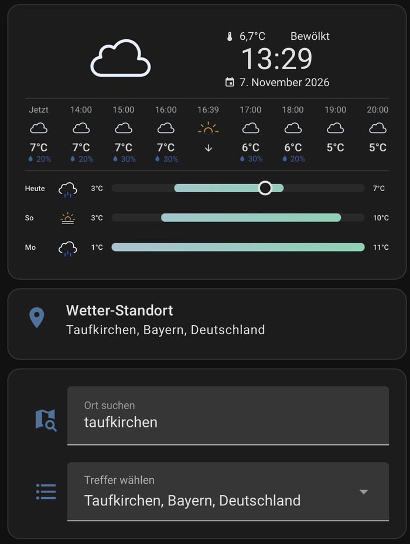
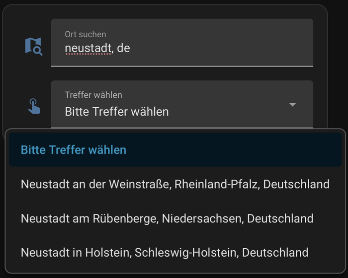
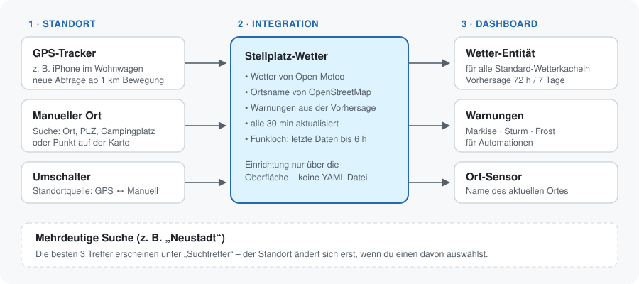

<p align="center">
  
</p>

<h1 align="center">Stellplatz-Wetter</h1>

<p align="center">
  Wetter mit Vorhersage für den Ort, an dem dein Wohnwagen oder Wohnmobil gerade steht –<br>
  als ganz normale Home-Assistant-Wetter-Entität.
</p>

<p align="center">
  <a href="https://github.com/hacs/integration"></a>
  
  
</p>

<p align="center">
  <a href="https://github.com/RainerBavaria/ha-stellplatz-wetter/actions/workflows/tests.yml"></a>
  <a href="https://github.com/RainerBavaria/ha-stellplatz-wetter/actions/workflows/validate.yml"></a>
</p>

<p align="center"><a href="README.en.md">English version</a> · <a href="CHANGELOG.md">Änderungsprotokoll</a></p>

---

## Wofür ist das?

Die eingebauten Wetterdienste von Home Assistant zeigen das Wetter für einen **festen** Ort. Im Wohnwagen
willst du aber das Wetter dort, wo du gerade stehst. Stellplatz-Wetter holt den Standort von einem
GPS-Tracker (z. B. einem alten iPhone im Wagen) oder lässt dich den Ort von Hand suchen – und stellt das
Wetter als **normale Wetter-Entität** bereit. Damit funktionieren alle üblichen Wetterkacheln.

- 📍 **Automatisch per GPS** – neue Abfrage, sobald sich der Wagen mehr als 1 km bewegt
- 🔎 **Manuell**: Suche nach Ort, Postleitzahl oder Campingplatz, oder Punkt auf der Karte setzen
- 🌦️ **Vorhersage** stündlich (72 h) und täglich (7 Tage)
- ⚠️ **Warnungen** für Markise, Sturm und Frost – Grenzwerte einstellbar
- 🏷️ **Ortsname** als Sensor
- 📶 **Funkloch-fest**: die letzten Daten bleiben bis zu 6 Stunden sichtbar
- 🖱️ **Keine YAML-Konfiguration** – alles über die Oberfläche

**Zusatzfunktionen** – einzeln einschaltbar, standardmäßig aus:

- ☀️ **Solar-Ertragsprognose** für deine Module (heute, morgen, Rest heute)
- 🌧️ **Regenwarnung**: „Regen in 24 Minuten“ (15-Minuten-Daten)
- ⛈️ **Gewitterwarnung** für die nächsten 6 Stunden
- 🌅 **Sonnenauf- und -untergang** am Standort
- ⭐ **Lieblingsplätze** speichern und am Display antippen
- 🚨 **Amtliche Unwetterwarnungen**: DWD in Deutschland, MeteoAlarm im europäischen Ausland

## So sieht es aus

<table>
  <tr>
    <td width="55%"></td>
    <td width="45%"></td>
  </tr>
  <tr>
    <td><sub>Clock Weather Card mit <code>weather.wohnwagen_wetter</code>, darunter Standort und Ortssuche</sub></td>
    <td><sub>Mehrdeutige Suche „neustadt, de“: die besten 3 Treffer zur Auswahl</sub></td>
  </tr>
</table>

## So funktioniert es



## Installation

### Über HACS (empfohlen)

1. In Home Assistant **HACS** öffnen → oben rechts **⋮** → **Benutzerdefinierte Repositories**
2. URL eintragen: `https://github.com/RainerBavaria/ha-stellplatz-wetter` · Typ: **Integration** → **Hinzufügen**
3. **Stellplatz-Wetter** suchen → **Herunterladen**
4. Home Assistant **neu starten**

### Von Hand

Den Ordner `custom_components/stellplatz_wetter` nach `/config/custom_components/` kopieren und
Home Assistant neu starten.

## Einrichtung

**Einstellungen → Geräte & Dienste → Integration hinzufügen → Stellplatz-Wetter**

| Feld | Bedeutung |
|---|---|
| **Name** | Bestimmt die Namen der Entitäten, z. B. „Wohnwagen“ → `weather.wohnwagen_wetter` |
| **Standort-Tracker** *(optional)* | `device_tracker` oder `person` mit GPS-Koordinaten, z. B. die Companion App auf einem iPhone im Wagen |
| **Manueller Ort** | Startpunkt, falls kein Tracker gewählt ist |

Später unter **Konfigurieren** änderbar:

| Option | Standard | Bedeutung |
|---|---|---|
| Standort-Tracker | – | Tracker wechseln oder entfernen |
| Manueller Ort | Heimatort | Punkt auf der Karte – wird er verschoben, wechselt die Quelle auf „Manueller Ort“ |
| Aktualisierung alle | 30 min | Abfrageintervall (10–180 min) |
| Markisenwarnung ab | 38 km/h | Böen in den **nächsten 3 Stunden** |
| Sturmwarnung ab | 75 km/h | Böen in den **nächsten 12 Stunden** |
| Frostwarnung ab | 2 °C | Tiefstwert der **nächsten 12 Stunden** |

### Zusatzfunktionen einschalten

Unter **Konfigurieren** gibt es für jede Zusatzfunktion einen Schalter. Eingeschaltete Funktionen legen ihre
Entitäten an, ausgeschaltete entfernen sie wieder sauber – es bleiben keine „nicht verfügbaren“ Reste zurück.

| Schalter | Was dazukommt |
|---|---|
| Solar-Ertragsprognose | Im zweiten Schritt: **Modulleistung** (Wp gesamt, Standard 200), **Neigung** (0° = flach auf dem Dach), **Ausrichtung** (0° = Süden, -90° = Osten, 90° = Westen), **Systemwirkungsgrad** (Standard 75 %) |
| Regenwarnung | 15-Minuten-Niederschlag für die nächsten 3 Stunden |
| Gewitterwarnung | Gewitter laut Vorhersage in den nächsten 6 Stunden |
| Sonnenauf-/untergang | Zeitpunkte am aktuellen Standort |
| Lieblingsplätze | Auswahlliste + Knopf „Ort als Lieblingsplatz merken“. Löschen über **Konfigurieren** → „Lieblingsplätze löschen“ |
| Amtliche Unwetterwarnungen | **Deutschland:** DWD, gemeindegenau. **Andere Länder Europas:** MeteoAlarm – Zuordnung über den Regionsnamen (Beta) |

> **Tipp für den Tracker:** Bei der iOS-Companion-App den Standortzugriff auf „Immer“ stellen,
> Hintergrundaktualisierung erlauben und das Gerät am Strom lassen.

## Entitäten

Beispiel für den Namen **„Wohnwagen“**:

| Entität | Inhalt |
|---|---|
| `weather.wohnwagen_wetter` | Aktuelles Wetter (Temperatur, gefühlt, Luftfeuchte, Luftdruck, Wind, Böen, Windrichtung, Bewölkung, UV) + Vorhersage |
| `sensor.wohnwagen_ort` | Ortsname. Attribute: `latitude`, `longitude`, `quelle`, `daten_veraltet`, `abgerufen` |
| `select.wohnwagen_standortquelle` | **GPS-Tracker** oder **Manueller Ort** |
| `text.wohnwagen_ortssuche` | Suchfeld: Ort, PLZ oder Campingplatz eintippen, mit Enter bestätigen |
| `select.wohnwagen_suchtreffer` | Bei mehreren Treffern: die besten 3 zur Auswahl. Attribut `auswahl_offen` |
| `binary_sensor.wohnwagen_markisenwarnung` | An, wenn Böen ≥ Grenzwert in den nächsten 3 h |
| `binary_sensor.wohnwagen_sturmwarnung` | An, wenn Böen ≥ Grenzwert in den nächsten 12 h |
| `binary_sensor.wohnwagen_frostwarnung` | An, wenn Tiefstwert ≤ Grenzwert in den nächsten 12 h |

**Zusatzfunktionen** (nur wenn eingeschaltet):

| Entität | Inhalt |
|---|---|
| `sensor.wohnwagen_solarprognose_heute` / `_morgen` / `_rest_heute` | Erwarteter Ertrag in kWh |
| `sensor.wohnwagen_regen_in` | Minuten bis zum nächsten Regen (*unbekannt* = kein Regen in den nächsten 3 h) |
| `binary_sensor.wohnwagen_regen_in_der_nachsten_stunde` | An, wenn in der nächsten Stunde Regen kommt. Attribut `menge_naechste_stunde_mm` |
| `binary_sensor.wohnwagen_gewitterwarnung` | An bei Gewitter in den nächsten 6 h. Attribut `erstes_gewitter` |
| `sensor.wohnwagen_sonnenaufgang` / `_sonnenuntergang` | Nächster Sonnenauf-/untergang |
| `select.wohnwagen_lieblingsplatze` | Gespeicherte Orte – Auswahl setzt den Standort |
| `button.wohnwagen_ort_als_lieblingsplatz_merken` | Aktuellen Ort speichern |
| `sensor.wohnwagen_amtliche_warnungen` | Anzahl aktiver Warnungen. Attribute: `hoechste_stufe` (0–4), `hoechste_stufe_text`, `warnungen` (Liste), `quelle` |

Werte des Attributs `quelle` am Ort-Sensor: `tracker` (aktuelle GPS-Position), `tracker_last_known`
(Tracker gerade nicht verfügbar – letzte bekannte Position), `manual`, `home` (Rückfall auf den Heimatort).

## Ortssuche

| Eingabe | Was passiert |
|---|---|
| `Grado` | eindeutiger Treffer → wird sofort übernommen |
| `Neustadt` | mehrere Treffer → unter **Suchtreffer** steht „Bitte Treffer wählen“, die besten 3 Orte zur Auswahl (Orte im eigenen Land zuerst). Der Standort ändert sich erst nach der Auswahl |
| `Neustadt Bayern` · `Neustadt, Bayern` | mit Bundesland/Region eingegrenzt – mit oder ohne Komma |
| `84130` | Postleitzahl – zuerst im Land deiner Home-Assistant-Einstellungen |
| `6020, AT` · `Grado, IT` · `Neustadt, DE` | mit Land eingegrenzt (Ländercode mit Komma am Ende) |
| `Camping Tenda Azzurra` | Freitext über OpenStreetMap, falls kein Ort gefunden wird |

Zurück zum GPS: **Standortquelle** auf **GPS-Tracker** stellen.

## Kachel-Beispiele

### Uhr, Datum und Vorhersage

Mit der [Clock Weather Card](https://github.com/pkissling/clock-weather-card) (über HACS installieren):

```yaml
type: custom:clock-weather-card
entity: weather.wohnwagen_wetter
forecast_rows: 4
locale: de
time_format: 24
```

### Vorhersage ohne Zusatzkarte

```yaml
type: weather-forecast
entity: weather.wohnwagen_wetter
forecast_type: daily
forecast_slots: 4
```

### Standort wählen

```yaml
type: vertical-stack
cards:
  - type: tile
    entity: sensor.wohnwagen_ort
    name: Wetter-Standort
    icon: mdi:map-marker
    features:
      - type: select-options
        entity: select.wohnwagen_standortquelle
  - type: entities
    entities:
      - entity: text.wohnwagen_ortssuche
        name: Ort suchen
        icon: mdi:map-search
      - entity: select.wohnwagen_suchtreffer
        name: Treffer wählen
```

Zeigt die obere Kachel den Umschalter nicht an, stattdessen diese Kachel verwenden:

```yaml
  - type: tile
    entity: select.wohnwagen_standortquelle
    name: Wetter-Standort
    features:
      - type: select-options
```

### Lieblingsplätze am Display

```yaml
type: entities
entities:
  - entity: select.wohnwagen_lieblingsplatze
    name: Lieblingsplatz
  - entity: button.wohnwagen_ort_als_lieblingsplatz_merken
    name: Aktuellen Ort merken
```

### Solar und Regen auf einen Blick

```yaml
type: glance
entities:
  - entity: sensor.wohnwagen_solarprognose_heute
    name: Solar heute
  - entity: sensor.wohnwagen_solarprognose_morgen
    name: Solar morgen
  - entity: sensor.wohnwagen_regen_in
    name: Regen in
  - entity: binary_sensor.wohnwagen_gewitterwarnung
    name: Gewitter
```

### Amtliche Warnungen nur bei Bedarf anzeigen

```yaml
type: conditional
conditions:
  - condition: numeric_state
    entity: sensor.wohnwagen_amtliche_warnungen
    above: 0
card:
  type: markdown
  content: >
    
    **{{ w.ueberschrift }}** ({{ w.quelle }})<br>{{ w.beschreibung }}
    
```

## Beispiel-Automation: Markise einfahren lassen

```yaml
alias: Markisenwarnung Wohnwagen
triggers:
  - trigger: state
    entity_id: binary_sensor.wohnwagen_markisenwarnung
    to: "on"
actions:
  - action: notify.notify
    data:
      title: Markise einfahren!
      message: >
        Böen bis {{ state_attr('binary_sensor.wohnwagen_markisenwarnung', 'max_boeen_kmh') }} km/h
        in {{ states('sensor.wohnwagen_ort') }} erwartet.
```

## Beispiel-Automation: Dachluke zu, Regen kommt

```yaml
alias: Regen kommt – Dachluke
triggers:
  - trigger: state
    entity_id: binary_sensor.wohnwagen_regen_in_der_nachsten_stunde
    to: "on"
actions:
  - action: notify.notify
    data:
      message: >
        Regen in {{ states('sensor.wohnwagen_regen_in') }} Minuten – Dachluke und Fenster schließen!
```

## Häufige Fragen

**Die Wetterkachel meldet „does not support forecasts“.**
Die Kachel nutzt eine andere Wetter-Entität. Prüfen, dass `weather.<name>_wetter` von Stellplatz-Wetter eingetragen ist.

**Der Ort springt nicht mit, obwohl der Wagen fährt.**
**Standortquelle** muss auf **GPS-Tracker** stehen. Unter *Entwicklerwerkzeuge → Zustände* prüfen, ob der Tracker
`latitude` und `longitude` liefert. Neu abgefragt wird erst ab 1 km Bewegung.

**Bei der Suche passiert nichts.**
Bei mehreren Treffern ändert sich der Standort bewusst noch nicht – **Suchtreffer** zeigt dann „Bitte Treffer wählen“.
Die Entität muss dafür in der Karte stehen (siehe *Standort wählen*).

**Wie genau ist die Solarprognose?**
Sie rechnet die vorhergesagte Einstrahlung auf deine Module um: Einstrahlung × Modulleistung × Wirkungsgrad.
Schatten, Schmutz und Batterie-Vollladung (Regler regelt ab) kennt sie nicht. Vergleiche ein paar Tage mit deinem
Laderegler und passe den Wirkungsgrad an.

**Warum zeigt die Regenwarnung im Ausland seltener etwas an?**
Echte 15-Minuten-Daten gibt es vor allem für Mitteleuropa. Anderswo werden sie aus Stundenwerten berechnet und sind gröber.

**Wie zuverlässig sind die amtlichen Warnungen im Ausland?**
In Deutschland fragt die Integration den DWD gemeindegenau ab. Im Ausland ordnet sie die MeteoAlarm-Warnungen über
Regionsnamen zu – das klappt nicht in jedem Land gleich gut. Im Zweifel die Warnungen des Landes direkt prüfen.

**Wie viele Abfragen macht die Integration?**
Wetter: alle 30 min (einstellbar) und nach einem Standortwechsel. Ortsname: nur, wenn sich der Standort um mehr als
1 km geändert hat. Amtliche Warnungen (falls eingeschaltet): zusammen mit dem Wetter. Das liegt weit unter den Grenzen
der kostenlosen Dienste.

## Entwicklung

Die Tests laufen bei jeder Änderung automatisch auf GitHub. Lokal:

```bash
pip install -r requirements_test.txt
pytest
```

## Fehler melden

Bitte ein [Issue](https://github.com/RainerBavaria/ha-stellplatz-wetter/issues) mit Home-Assistant-Version,
Integrations-Version und den Log-Einträgen anlegen.

Am hilfreichsten ist die **Diagnose-Datei**: *Einstellungen → Geräte & Dienste → Stellplatz-Wetter → ⋮ → Diagnose
herunterladen*. Koordinaten, Ortsnamen und Lieblingsplätze sind darin unkenntlich gemacht.

Ausführliche Logs ohne YAML: *Einstellungen → Geräte & Dienste → Stellplatz-Wetter → ⋮ → Debug-Protokollierung aktivieren*,
Fehler nachstellen, dann Debug-Protokollierung wieder ausschalten – die Log-Datei wird automatisch heruntergeladen.

## Datenquellen und Lizenz

- Wetterdaten: [Open-Meteo.com](https://open-meteo.com) – CC BY 4.0, kostenlos für die private Nutzung
- Ortsnamen und PLZ-Suche: © [OpenStreetMap](https://www.openstreetmap.org/copyright)-Mitwirkende (Nominatim)
- Amtliche Warnungen: [Deutscher Wetterdienst](https://www.dwd.de) (Geodienste) und [MeteoAlarm](https://meteoalarm.org) (EUMETNET)
- Code: [MIT-Lizenz](LICENSE)
